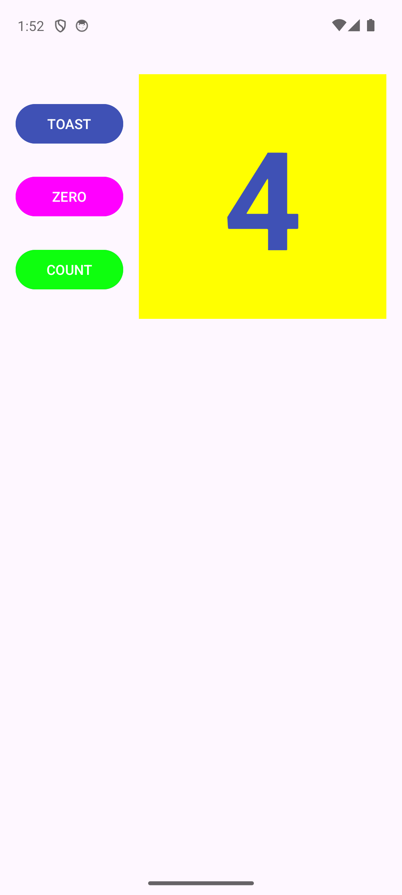
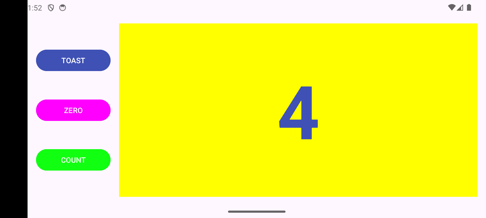
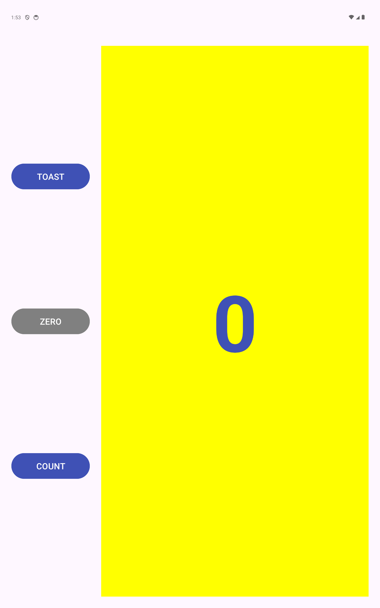

# Uporabniški vmesnik (HelloConstraint)

Preprosta interaktivna Android aplikacija s števcem, narejena pri predmetu MOAp. Namen naloge je spoznavanje postavitve ConstraintLayout, odzivanja na klike in prilagajanja postavitve različnim zaslonom.

## Opis aplikacije

Aplikacija vsebuje naslednje elemente uporabniškega vmesnika:
- Prikazovalnik števila (privzeto nastavljen na 0).
- Gumb **Toast**, ki ob kliku prikaže kratko obvestilo s trenutno vrednostjo števca.
- Gumb **Count**, ki ob vsakem kliku poveča števec za 1 ter spreminja svojo barvo glede na sodo ali liho vrednost.
- Gumb **Zero**, ki ponastavi števec nazaj na 0 ter svojo barvo ponastavi na privzeto sivo.
- Prilagojeno postavitev za ležeči način (**landscape**) in večje tablične zaslone (**tablet**).

Vsa besedila v aplikaciji so shranjena v `strings.xml`.

## Posnetki aplikacije
| | | | |
|---|---|---|---|
|[Začetni pogled](screenshot_initial.png)||||